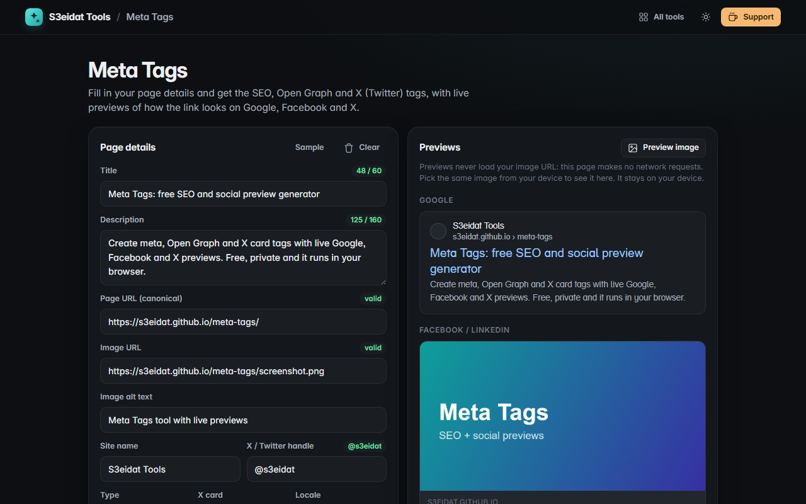

# Meta Tags

> Generate SEO, Open Graph and X (Twitter) card meta tags with live previews. Free, private, and it runs entirely in your browser.

### ▶ [Open Meta Tags](https://s3eidat.github.io/meta-tags/)



## Features

- One form for **title, description, canonical URL, image, image alt, site name, X handle, type, card style and locale**
- Generates `<title>`, `meta description`, `canonical`, **Open Graph** and **X / Twitter card** tags, ready to paste into `<head>`
- **Live previews** of a Google result, a Facebook / LinkedIn link card and an X card (large image or summary)
- **Length checks**: title and description counters with “short”, “may be cut” and “too long” warnings; URL and handle validation
- Everything you type is HTML-escaped in the output, and previews show it as plain text
- Accepts `yoursite.com/page` and fills in `https://`; accepts `x.com/handle` or `@handle`
- Copy or download the tags; the form is remembered on this device

**About the image preview:** the page never loads your image URL (it makes no network requests at all).
To see the image in the cards, pick the same file from your device; it is shown locally and never uploaded.

## Privacy

Nothing you type leaves your device. There is no server, no account, no analytics.
The page ships with a strict Content-Security-Policy (`connect-src 'self'`), so the browser
itself blocks any attempt to send data anywhere.

## Run it yourself

It's plain HTML, CSS and JavaScript with no build step:

```bash
git clone https://github.com/s3eidat/meta-tags
cd meta-tags
python -m http.server 8000
```

Then open http://localhost:8000.

## Support

If this saved you time, **[buy me a coffee ☕](https://s3eidat.github.io/coffee/)**. It keeps every tool free.

---

Part of **[S3eidat Tools](https://s3eidat.github.io/)**: 100+ free, private tools that run in your browser. MIT licensed.
